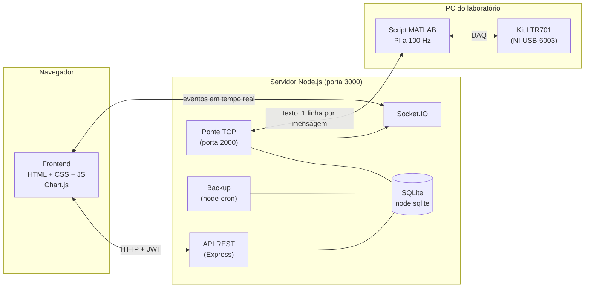

# Projeto Integrador SCOM 2026 — Dashboard LTR701

Sistema web para **controle remoto e monitoramento em tempo real** do kit de temperatura **LTR701** (soprador térmico). O navegador fala com um servidor Node.js (API REST + Socket.IO), que por sua vez conversa por **TCP** com um script **MATLAB** responsável pelo controle PI a 100 Hz e pela interface com o kit.

> Disciplina: SCOM (UNESP Sorocaba) · Integra-se com o projeto de LCON-I (controle da planta de temperatura em MATLAB).

---

## Sumário

- [Funcionalidades](#funcionalidades)
- [Arquitetura em uma imagem](#arquitetura-em-uma-imagem)
- [Tecnologias](#tecnologias)
- [Estrutura de pastas](#estrutura-de-pastas)
- [Como executar](#como-executar)
- [Modos de operação](#modos-de-operação)
- [Níveis de acesso](#níveis-de-acesso)
- [Testes](#testes)
- [Documentação detalhada](#documentação-detalhada)
- [Limitações conhecidas](#limitações-conhecidas)

---

## Funcionalidades

| Área | O que o sistema faz |
|---|---|
| **Controle** | Liga/desliga o controle e envia o *setpoint* (0–99 °C) ao MATLAB. Esses são os **únicos** dados que descem até o kit; os ganhos Kp/Ki ficam no script MATLAB. |
| **Tempo real** | Temperatura filtrada vinda do MATLAB chega ao navegador por Socket.IO (evento `reading`) e alimenta os gráficos e a *sombra digital* do kit. |
| **Sombra digital** | Desenho SVG do kit soprando ar, com cor do ar, temperatura, setpoint e estado (ligado/desligado) em destaque. Funciona nos três modos. |
| **Simulação local** | Planta G(z) + controlador PI rodando no navegador (sem MATLAB), com setpoint 1/2, perturbação e ganhos configuráveis. |
| **Séries históricas** | Média, variância, desvio padrão, assimetria, curtose e outliers (critério de Tukey, 1,5·IQR) sobre a temperatura. O admin pode restaurar a série a partir do banco por intervalo de datas. |
| **Autenticação** | Cadastro e login com senha em bcrypt, JWT de 8 h e bloqueio da conta após 5 falhas. |
| **2 níveis de acesso** | `admin` e `comum`. O primeiro usuário cadastrado vira admin; admins gerenciam papéis e contas. |
| **Criptografia** | Dados de medição, comandos e mensagens de log gravados cifrados com AES-256-GCM. |
| **Logs** | Auditoria na tabela `logs`, em arquivo `backend/logs/sistema.log` e ao vivo para admins. |
| **Backup/restauração** | Backup diário automático (cron), backup manual e restauração com verificação SHA-256 e de integridade. |

## Arquitetura em uma imagem



Detalhes em [`docs/arquitetura.md`](docs/arquitetura.md).

## Tecnologias

- **Backend:** Node.js ≥ 22.13 (o projeto foi executado com Node 26), Express 4, Socket.IO 4, `node:sqlite` (módulo nativo, sem driver externo), bcryptjs, jsonwebtoken, node-cron, dotenv.
- **Banco:** SQLite em modo WAL.
- **Frontend:** HTML/CSS/JavaScript puro, Chart.js (via CDN), cliente Socket.IO servido pelo próprio servidor.
- **Controle:** MATLAB com Data Acquisition Toolbox (`daq("ni")`) e `tcpclient`.
- **Simulação auxiliar:** Python 3 com `requests` (`Simulação/usuario.py`).

## Estrutura de pastas

```text
Projeto Integrador/
├── backend/
│   ├── server.js              # ponto de entrada (API + Socket.IO + estáticos)
│   ├── package.json
│   ├── .env                   # segredos (não versionar)
│   ├── src/
│   │   ├── db.js              # conexão SQLite, criação das tabelas, kit padrão
│   │   ├── auth.js            # middlewares JWT e papel admin
│   │   ├── cripto.js          # AES-256-GCM
│   │   ├── logger.js          # banco + arquivo + console + socket
│   │   ├── backup.js          # backup, retenção e restauração
│   │   ├── sockets.js         # Socket.IO autenticado
│   │   ├── tcpBridge.js       # ponte TCP com o MATLAB
│   │   └── routes/            # auth, commands, readings, sistema, usuarios, backup
│   ├── tests/api.test.js      # testes de integração (node --test)
│   ├── backups/               # arquivos .db dos backups (gerado)
│   └── logs/sistema.log       # log em arquivo (gerado)
├── Banco de Dados/
│   ├── schema.sql             # esquema das tabelas
│   └── integrador.db          # banco em uso (gerado)
├── frontend/
│   ├── html/                  # login, cadastro, index (Resposta PID), estatistica, sistema, usuarios
│   ├── css/
│   └── js/                    # auth, main, status, kit, simulacao, estatistica, sistema, usuarios
├── MATLAB/
│   ├── controle_kit_web.m         # controle real: kit LTR701 + TCP
│   └── temperature_client_node.m  # simulação do professor (sem kit)
├── Simulação/
│   └── usuario.py             # cliente Python que envia comandos pela API
├── docs/                      # documentação detalhada
├── env.example                # modelo do arquivo .env
└── .gitignore
```

## Como executar

### 1. Pré-requisitos

- Node.js 22.13 ou superior (`node -v`).
- MATLAB com *Data Acquisition Toolbox* (apenas para os modos com MATLAB).
- Python 3 (opcional, só para `Simulação/usuario.py`).

### 2. Configurar o `.env`

Copie `env.example` para `backend/.env` e preencha:

```bash
# gerar JWT_SECRET (qualquer string longa) e ENC_KEY (64 hex = 32 bytes)
node -e "console.log(require('crypto').randomBytes(32).toString('hex'))"
```

Variáveis principais: `JWT_SECRET`, `ENC_KEY`, `PORT`, `TCP_HOST`, `TCP_PORT`, `DB_PATH`, `SCHEMA_PATH`. A lista completa está em [`docs/instalacao-e-execucao.md`](docs/instalacao-e-execucao.md).

> ⚠️ **Guarde a `ENC_KEY`.** Sem ela, os dados cifrados no banco e nos backups não podem ser lidos.

### 3. Instalar e iniciar o servidor

```bash
cd backend
npm install
npm start          # ou: npm run dev (reinicia ao salvar)
```

O terminal deve mostrar o servidor em `http://localhost:3000`, a ponte TCP em `127.0.0.1:2000` e o agendamento do backup.

### 4. Criar a primeira conta

Abra `http://localhost:3000`, vá em **Cadastro** e crie o usuário. **O primeiro cadastro é administrador.**

### 5. (Opcional) Conectar o MATLAB

1. Abra `MATLAB/controle_kit_web.m` e preencha `Kp` e `Ki` (projetados em LCON-I). O script se recusa a rodar com `NaN`.
2. Se o MATLAB estiver em outro PC, ajuste `SERVER_IP` e use `TCP_HOST=0.0.0.0` no `.env`.
3. Execute o script. O indicador **MATLAB: Online** aparece no dashboard e só então o botão **Ligar** é aceito.

Para treinar sem o kit, use `temperature_client_node.m`.

## Modos de operação

| Modo | Onde roda a malha | Script esperado |
|---|---|---|
| **Local** | Navegador (planta G(z) + PI em JS) | nenhum |
| **Simulada** | MATLAB, sem kit | `temperature_client_node.m` |
| **Real** | MATLAB + kit LTR701 | `controle_kit_web.m` |

## Níveis de acesso

| Recurso | Comum | Admin |
|---|:--:|:--:|
| Dashboard, ligar/desligar, enviar setpoint | ✅ | ✅ |
| Ver leituras e histórico de comandos | ✅ | ✅ |
| Séries históricas (série da sessão) | ✅ | ✅ |
| Restaurar série do banco | ❌ | ✅ |
| Status e Logs | ❌ | ✅ |
| Backup e restauração | ❌ | ✅ |
| Gerenciar usuários | ❌ | ✅ |

## Testes

```bash
cd backend
npm test
```

Sobe um servidor isolado (porta, banco e chave temporários) e cobre autenticação, autorização, validação de comandos, ponte TCP com um "MATLAB falso", criptografia e backup/restauração. Veja [`docs/testes.md`](docs/testes.md).

## Documentação detalhada

| Documento | Conteúdo |
|---|---|
| [`docs/arquitetura.md`](docs/arquitetura.md) | Componentes, fluxos de dados, diagramas de sequência |
| [`docs/api.md`](docs/api.md) | Todos os endpoints REST e eventos Socket.IO |
| [`docs/banco-de-dados.md`](docs/banco-de-dados.md) | Tabelas, relacionamentos e o que é cifrado |
| [`docs/seguranca.md`](docs/seguranca.md) | Autenticação, autorização, criptografia, logs, proteções do kit |
| [`docs/protocolo-matlab.md`](docs/protocolo-matlab.md) | Protocolo TCP e comportamento do script `controle_kit_web.m` |
| [`docs/frontend.md`](docs/frontend.md) | Páginas, scripts, modos e estatísticas |
| [`docs/instalacao-e-execucao.md`](docs/instalacao-e-execucao.md) | Variáveis do `.env`, passo a passo, solução de problemas |
| [`docs/backup-e-restauracao.md`](docs/backup-e-restauracao.md) | Política de backup e procedimento de restauração |
| [`docs/testes.md`](docs/testes.md) | Cobertura dos testes e como validar manualmente |

## Limitações conhecidas

- Há **um único kit** e **uma única conexão MATLAB** por vez; uma conexão nova substitui a anterior.
- A ponte TCP **não tem autenticação**: por padrão escuta só em `127.0.0.1`. Se abrir para a rede (`0.0.0.0`), use firewall/VPN.
- Não há HTTPS embutido; para uso fora do laboratório, coloque um proxy reverso com TLS na frente.
- O token JWT fica no `localStorage` do navegador (expira em 8 h).
- Tabelas `refresh_tokens` e `experimentos` e colunas `kp`, `ki`, `kd`, `pwm` existem no esquema mas **não são preenchidas** pela versão atual (`experimentos` só participa da restauração de backup).
