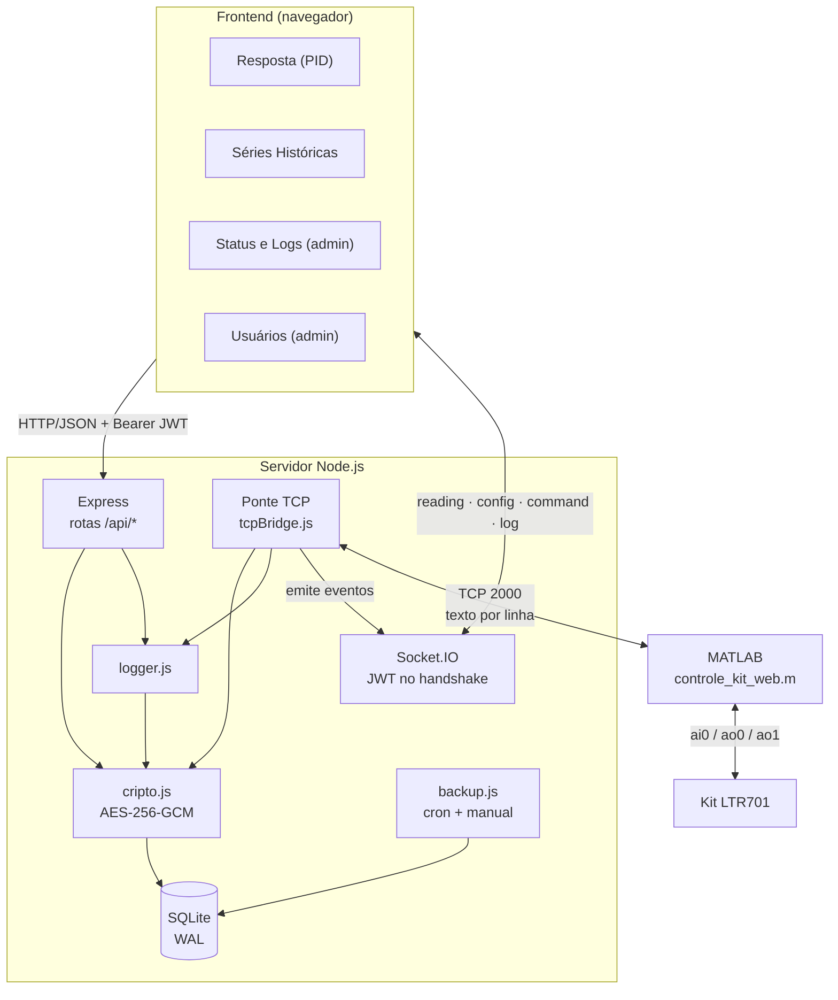
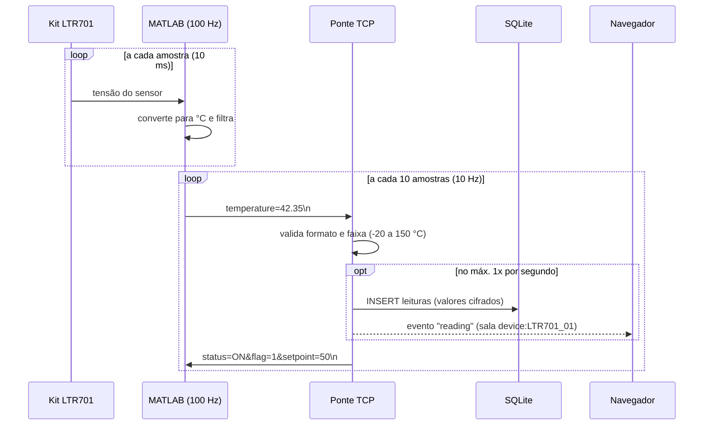
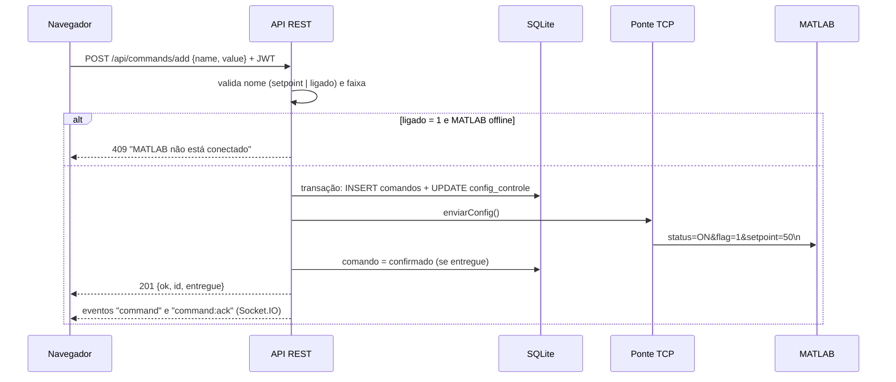

# Arquitetura

## Visão geral

O sistema tem quatro blocos: **frontend** (navegador), **servidor Node.js**, **script MATLAB** e **kit LTR701**. O servidor serve o frontend e a API na mesma origem (porta 3000), o que dispensa CORS.

## Responsabilidades

| Componente | Arquivo | Responsabilidade |
|---|---|---|
| Entrada | `backend/server.js` | Valida `JWT_SECRET`, monta rotas, serve o frontend, trata erros |
| Banco | `src/db.js` | Abre o SQLite (WAL, chaves estrangeiras), aplica `schema.sql` se faltar, cadastra o kit |
| Autenticação | `src/auth.js` | Valida JWT e confere se o usuário existe e está ativo; middleware de admin |
| Criptografia | `src/cripto.js` | `encText/decText/encNum/decNum` com AES-256-GCM |
| Logs | `src/logger.js` | Grava no banco (cifrado), no arquivo, no console e emite para a sala `admins` |
| Tempo real | `src/sockets.js` | Socket.IO exige JWT; organiza salas `user:<id>`, `device:<id>` e `admins` |
| Ponte TCP | `src/tcpBridge.js` | Recebe temperatura do MATLAB, grava, repassa ao navegador e devolve `flag`/`setpoint` |
| Backup | `src/backup.js` | `VACUUM INTO`, retenção, restauração controlada |
| Rotas | `src/routes/*.js` | Ver [`api.md`](api.md) |

## Fluxo 1 — Leitura de temperatura (MATLAB → navegador)

- O MATLAB pode enviar a 10 Hz (ou mais); o servidor **grava e emite no máximo 1 vez por segundo** para não inflar o banco.
- A resposta ao MATLAB sai imediatamente se a configuração mudou, ou, no máximo, 10 vezes por segundo.

## Fluxo 2 — Comando do usuário (navegador → MATLAB)

Como não há *acknowledge* de aplicação no protocolo, **"confirmado" significa "escrito no socket TCP"**. Se o MATLAB estiver offline, o comando fica `pendente` e a configuração é aplicada na próxima conexão (exceto `ligado`, que sempre começa em 0; veja abaixo).

## Fluxo 3 — Conexão e desconexão do MATLAB

Ao conectar, a ponte:

1. Substitui qualquer conexão anterior (só um MATLAB por vez).
2. Marca como `falhou` os comandos `pendente`/`enviado` antigos.
3. **Desliga o controle** (`ligado = 0`) e avisa os navegadores.
4. Registra o log `matlab_conectado`.

Ao desconectar (ou por *timeout* de 10 s sem dados), a ponte **desliga o controle** de novo e registra `matlab_desconectado`. O aquecedor **nunca liga sozinho**: sempre exige um novo "Ligar" do usuário.

## Camadas de proteção do kit

Ver [`seguranca.md`](seguranca.md#proteções-do-hardware). Em resumo: servidor recusa ligar sem MATLAB; MATLAB desliga sozinho se o servidor ficar mudo por 2 s; trava em 95 °C; saturação de 9,5 V; ventilador/aquecedor zerados ao encerrar.

## Salas do Socket.IO

| Sala | Quem entra | Uso |
|---|---|---|
| `user:<id>` | o próprio usuário | derrubar sockets quando papel/ativação mudam |
| `device:<device_id>` | todo usuário autenticado | `reading`, `config`, `command`, `command:ack` |
| `admins` | só administradores | evento `log` em tempo real |

## Decisões de projeto

| Decisão | Motivo |
|---|---|
| Ponte TCP em vez de HTTP com o MATLAB | O script do professor já usa `tcpclient`; TCP dá latência baixa e conexão persistente |
| Controle a 100 Hz **no MATLAB** | O envio ao servidor não pode comprometer o laço; a leitura é não bloqueante |
| Só `ligado` e `setpoint` descem ao kit | Requisito do enunciado; Kp/Ki ficam no MATLAB |
| SQLite (`node:sqlite`) | Sem servidor de banco para instalar; um arquivo só; fácil de fazer backup |
| Frontend na mesma origem da API | Sem CORS; um único comando para subir tudo |
| Socket.IO | Reconexão automática, salas e autenticação no handshake |
