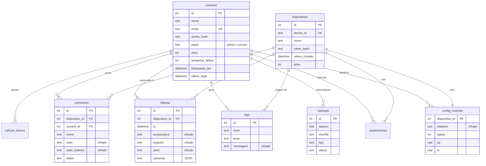

# Banco de dados

SQLite acessado pelo módulo nativo `node:sqlite`. O arquivo fica em `Banco de Dados/integrador.db` (caminho definido por `DB_PATH`). Na primeira execução, se a tabela `usuarios` não existir, `db.js` aplica `Banco de Dados/schema.sql`. O banco opera em modo **WAL** com `foreign_keys = ON`.

> Os arquivos `integrador.db-wal` e `integrador.db-shm` são auxiliares do modo WAL. Não os apague com o servidor ligado.

## Diagrama entidade-relacionamento



## Tabelas

| Tabela | Finalidade | Situação na versão atual |
|---|---|---|
| `usuarios` | Contas, papel (`admin`/`comum`), bloqueio por tentativas | Em uso |
| `dispositivos` | Cadastro do kit (`LTR701_01`) | Em uso (`token_hash` é um valor descartável, só para satisfazer `NOT NULL`) |
| `leituras` | Série de temperatura gravada pela ponte TCP (≤ 1/s) | Em uso (`pwm` sempre `NULL`: o MATLAB só envia temperatura) |
| `comandos` | Histórico de `setpoint` e `ligado`, com valor anterior e status | Em uso |
| `config_controle` | Estado atual: `setpoint` e `ligado` | Em uso. Colunas `kp`, `ki`, `kd`, `sat_min`, `sat_max` mantêm só os padrões |
| `logs` | Auditoria | Em uso |
| `backups` | Registro dos arquivos de backup, tamanho e SHA-256 | Em uso |
| `refresh_tokens` | Reservada para renovação de sessão | **Não utilizada** (sessão é um JWT de 8 h) |
| `experimentos` | Reservada para registrar cenários/métricas | **Não preenchida**; participa da restauração de backup |

## O que é cifrado (AES-256-GCM)

| Tabela.coluna | Conteúdo |
|---|---|
| `leituras.temperatura`, `.setpoint`, `.pwm` | valores numéricos |
| `comandos.valor`, `.valor_anterior` | valores dos comandos |
| `config_controle.setpoint` | setpoint atual |
| `logs.mensagem` | texto do log |

Formato gravado: `v1:<iv>:<tag>:<cifrado>` (cada parte em base64, IV novo por registro). Colunas `ts`, `nivel`, `acao`, `ip` e `ligado` ficam em claro para permitir ordenação e filtros. Valores antigos sem o prefixo `v1:` são lidos como estão (dados legados).

As **senhas** não usam AES: são guardadas como hash **bcrypt** (custo 12).

## Índices

| Índice | Uso |
|---|---|
| `idx_leituras_disp_ts (dispositivo_id, ts DESC)` | últimas leituras e histórico por período |
| `idx_comandos_pendentes (dispositivo_id, status)` parcial | comandos `pendente`/`enviado` |
| `idx_logs_criado (criado_em DESC)` | listagem de logs |

## Regras de integridade

- `papel` ∈ `admin | comum`; `nivel` ∈ `INFO | WARN | ERROR`; `status` do comando ∈ `pendente | enviado | confirmado | falhou`.
- Remover um usuário zera (`SET NULL`) as referências em leituras, comandos, logs e backups; remover um dispositivo apaga em cascata leituras, comandos e configuração.
- Os valores cifrados são `TEXT`: **não é possível** fazer `AVG`, `ORDER BY` ou comparação numérica direto no SQL. A estatística é calculada depois de descriptografar.

## Consultas úteis

```sql
-- usuários e papéis
SELECT id, email, papel, ativo FROM usuarios;

-- últimos backups
SELECT id, arquivo, tipo, status, criado_em FROM backups ORDER BY id DESC LIMIT 10;

-- nº de leituras por dia (ts está em claro)
SELECT substr(ts,1,10) AS dia, COUNT(*) FROM leituras GROUP BY dia;
```

O conteúdo cifrado só pode ser lido pela aplicação (que conhece a `ENC_KEY`).
