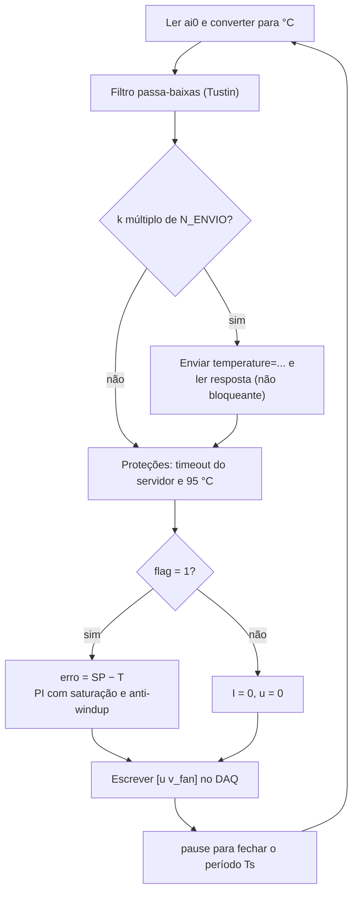

# Protocolo TCP e script MATLAB

O MATLAB é **cliente TCP** da ponte do servidor (`src/tcpBridge.js`). Toda a comunicação é texto ASCII, **uma mensagem por linha** (terminada em `\n`).

## Parâmetros de conexão

| Item | Valor padrão | Onde mudar |
|---|---|---|
| Host do servidor | `127.0.0.1` | `SERVER_IP` no `.m`; `TCP_HOST` no `.env` (`0.0.0.0` para outro PC) |
| Porta | `2000` | `SERVER_PORT` no `.m`; `TCP_PORT` no `.env` |
| Conexões simultâneas | 1 | conexão nova **substitui** a antiga |

## Mensagens

### MATLAB → servidor

```text
temperature=<°C>\n
```

Exemplo: `temperature=42.35`. Regex aceita pelo servidor: `^temperature=(-?\d+(\.\d+)?)$`. Valores fora de **−20 a 150 °C** e linhas fora do formato são ignorados em silêncio.

### Servidor → MATLAB

```text
status=ON|OFF&flag=1|0&setpoint=<°C>\n
```

Exemplo: `status=ON&flag=1&setpoint=50`.

| Campo | Significado |
|---|---|
| `status` | `ON` se o controle está ligado, `OFF` caso contrário |
| `flag` | `1` = executar controle e ligar o ventilador; `0` = desligar tudo |
| `setpoint` | referência de temperatura em °C (0 a 99) |

**Somente `flag` e `setpoint` descem ao kit.** Os ganhos Kp/Ki **não** são transmitidos.

## Temporização

| Quem | Regra |
|---|---|
| MATLAB | Envia a cada `N_ENVIO = 10` amostras (10 Hz com Fs = 100 Hz) |
| Servidor | Responde na hora se `status/flag/setpoint` mudaram; senão, no máx. 10×/s |
| Servidor | Grava no banco e emite ao navegador no máx. 1×/s |
| Servidor | Sem dados por 10 s → derruba o socket |

## O que o servidor faz em cada evento

| Evento | Ação do servidor |
|---|---|
| MATLAB conecta | Substitui conexão anterior; comandos `pendente/enviado` → `falhou`; `ligado = 0`; log `matlab_conectado` |
| `temperature=...` | Valida, (a cada 1 s) grava em `leituras` e emite `reading`; responde `status=...` |
| Usuário envia comando | `enviarConfig()` escreve a resposta no socket imediatamente |
| MATLAB desconecta | `ligado = 0`; emite `config` com `motivo`; log `matlab_desconectado` (WARN) |

## `MATLAB/controle_kit_web.m` (modo real)

Une o script de controle do laboratório (NI-USB-6003) com o protocolo acima.

### Configuração antes de rodar

| Variável | Descrição |
|---|---|
| `Kp`, `Ki` | Ganhos do PI projetados em LCON-I. **Obrigatório**: o script dá erro enquanto forem `NaN` |
| `SERVER_IP`, `SERVER_PORT` | Endereço da ponte |
| `V2C` | Conversão tensão → °C do kit: `T = 9,0·V + 1,45` |
| `V_MAX` | Saturação do aquecedor (9,5 V) |
| `V_FAN` | Tensão fixa do ventilador (2,5 V) |
| `T_SEGURA` | Limite de proteção (95 °C) |
| `TIMEOUT_SERVIDOR` | 2 s sem resposta → desliga |
| `ENCERRAR_AO_DESLIGAR` | `true` encerra o script ao clicar em Desligar |

### Hardware (DAQ `Dev1`)

| Canal | Função |
|---|---|
| `ai0` | Sensor de temperatura (SENSOR 2), `SingleEnded` |
| `ao0` | Aquecedor (ACTUATOR 2) |
| `ao1` | Ventilador (ACTUATOR 1) |

### Laço principal (100 Hz, `Ts = 10 ms`)



- **Filtro:** passa-baixas de 1ª ordem discretizado por Tustin, `τ = 0,012732 s`.
- **PI:** `u = Kp·e + I`, com `I += Ki·e·Ts`; `u` saturado em 0–9,5 V. O integrador só é atualizado quando não há saturação (**anti-windup por integração condicional**).
- **Ventilador:** `V_FAN` enquanto o dashboard estiver ligado (inclusive em sobretemperatura, para resfriar); zero ao desligar, perder o servidor ou perder a conexão.
- **Reconexão:** se o servidor cair, o script mantém o laço, desliga o controle e tenta reconectar a cada 3 s.
- **Envio não bloqueante:** só lê o socket se `NumBytesAvailable > 0`, para não atrasar o laço de 100 Hz. Usa sempre a resposta **mais recente**.
- **Encerramento seguro:** `onCleanup` zera `[0 0]` no DAQ e fecha o TCP (Ctrl+C, erro ou fim do script).

## `MATLAB/temperature_client_node.m` (simulação)

Script do professor. Simula a planta dentro do MATLAB (sem kit): com `status=ON` a temperatura sobe em direção ao setpoint (com um pequeno ruído); com `OFF` ela volta à temperatura ambiente (21 °C). Envia `temperature=` a **20 Hz** (a cada laço) e lê `status=...&setpoint=...`. Serve para testar toda a cadeia web ↔ MATLAB sem hardware.

> A resposta do servidor inclui o campo `flag`, que esse script ignora; ele usa `status`. O `controle_kit_web.m` aceita os dois (usa `status` se `flag` faltar).

## Teste do protocolo sem MATLAB

```bash
# terminal 1: servidor rodando
# terminal 2: cliente TCP manual
nc 127.0.0.1 2000
temperature=25.0        # digite e Enter
# resposta: status=OFF&flag=0&setpoint=<valor atual>
```

No Windows (sem `nc`), use o cliente MATLAB de simulação ou o "MATLAB falso" de `backend/tests/api.test.js`.

> Enquanto nenhum setpoint tiver sido enviado pela web, o servidor responde `setpoint=0`. O `controle_kit_web.m` ignora valores fora de (0, 100) e mantém o setpoint inicial de 25 °C.
